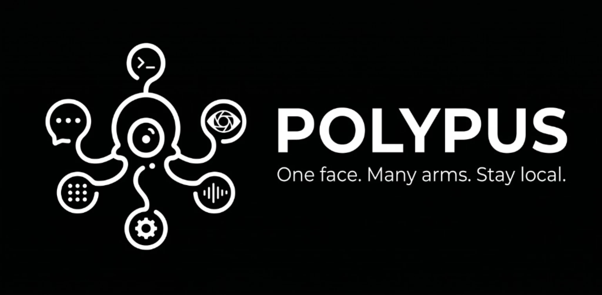

<p align="center">
  
</p>

# Polypus: one OpenAI-compatible face for every model your apps call.

Polypus is an **inference gateway**. Your apps, agents and n8n flows speak the OpenAI API to one address, and Polypus routes each call to the right arm: local MLX speech, LM Studio, OpenRouter, Claude, Gemini or Cloudflare Workers AI. **Apps never hold a provider URL or key**; the gateway does.

Runtime today: a **Go binary** (`polypus`) that serves the gateway, plus an **NVIDIA Switchyard** sidecar for routers that pick a model per turn. Phoenix and HyperDX show every call.

---

**Agents:** start at [AGENTS.md](AGENTS.md).  
**Routers:** [docs/switchyard/](docs/switchyard/) explains each routing type and when to use it.

---

## 💡 Why this exists

**Every app should not learn every provider.** Each one has its own API shape, keys, limits and failure modes. Teams end up copying keys into every app, rewriting clients when a model moves, and guessing why a call failed.

Polypus puts that in one place:

| Layer | Role |
|-------|------|
| **Gateway** | One OpenAI-compatible surface; picks a backend by model prefix or capability default |
| **Backends** | OpenAI-compatible servers, plus extensions for Claude, Gemini and Cloudflare |
| **Switchyard** | Named routers (`router/<name>`) that choose a cheap or strong model per turn |
| **Observability** | OTLP traces to Phoenix and HyperDX, and a JSON dump for each failed call |

Swapping a model, a provider or a key becomes a gateway config change. **The apps stay the same.**

## 🧭 What ships today

| Capability | How |
|------------|-----|
| **Chat and vision** | `POST /v1/chat/completions`, streamed or not, with tools |
| **Embeddings** | `POST /v1/embeddings` |
| **Speech** | `POST /v1/audio/speech`, `/v1/audio/transcriptions`, `GET /v1/audio/voices` |
| **Batches** | `POST /v1/files` and `/v1/batches` over the provider's own batch API |
| **SystemOne** | `POST /v1/systemone` for TypeSafe and Decider structured evaluation |
| **Model catalogue** | `GET /v1/models`, with an optional allow list per backend |
| **Routers** | `model: router/<name>`: stage router, LLM classifier, random, passthrough, fallback |
| **Access keys** | Optional lock with gateway keys (`polypus admin-key`) |
| **Failure dumps** | `GET /debug/failures/<trace id>` returns what went wrong, readable by an agent |

## 🏠 Run it on your machine

`polypus serve` starts the gateway on `127.0.0.1:1320`. The local stack runs it under process-compose, with the MLX speech backend, Switchyard, Phoenix and HyperDX beside it.

```bash
go tool task init     # writes ~/.config/polypus/config.yaml from the example
go tool task build    # bin/polypus and bin/switchyard-server
go tool task serve    # gateway :1320, backends, Phoenix :6006, HyperDX :8080
go tool task serve-down
```

Config lives at `~/.config/polypus/config.yaml` (override with `POLYPUS_CONFIG`). Keys come from the environment or the OS keyring (`polypus secret set`), never from the YAML.

```bash
curl -sS http://127.0.0.1:1320/v1/models | jq .
```

## 🚀 Deploy it for a team

`polypus deploy` runs the whole stack with Docker Compose: the gateway, Switchyard, an OTLP collector, Phoenix, HyperDX and Tailscale. **Nothing publishes a host port.** People reach the gateway at `https://polypus-<identifier>.<tailnet>`, so only machines on your tailnet can call it.

```bash
polypus deploy init                       # a starting environment under ~/.config/polypus/deploy/
polypus deploy secret set TS_AUTHKEY      # each secret goes to the OS keyring
polypus deploy run --dry-run              # prints the plan; writes nothing
polypus deploy run                        # deploys, then checks health and smoke tests every router
polypus deploy client-key                 # locks the gateway with a client key
```

The binary carries its own stack, so **no Polypus checkout is needed**. Each environment is its own compose project, Tailscale host and keyring service, so several can run side by side on one machine.

## 📦 Install

Download the `polypus` archive for your OS from the [latest release](https://github.com/behaviorengineering/polypus/releases/latest), unpack it, and put `polypus` on your `PATH`. Releases ship for Linux, macOS and Windows, on `amd64` and `arm64`.

```bash
polypus version
polypus            # prints the operating guide and every command
```

Or run a release straight from Go:

```bash
go run github.com/behaviorengineering/polypus/cmd/polypus@latest version
```

Container images publish to GHCR as `ghcr.io/behaviorengineering/polypus` and `ghcr.io/behaviorengineering/polypus-switchyard`, for `linux/amd64` and `linux/arm64`.

## Releases (for agents)

1. **Full product release:** merge releasable changes to `main`. **Auto patch release** cuts git tag `vX.Y.Z`, runs GoReleaser, calls **Docker release** (reusable workflow), and **verify** inspects GHCR `X.Y.Z` (and `:latest` when applicable). Binaries and images share app version `X.Y.Z`.

2. **Packaging-only / base image rebuild:** when the diff since the last `v*` tag touches only Docker/packaging paths, **Auto patch** skips Go tagging. **Packaging rebuild** (after green **CI** on `main`, or manual dispatch) publishes immutable GHCR tags `X.Y.Z-rN` (`N >= 1`) using binaries from the existing `vX.Y.Z` GitHub Release. Do not cut a new Go tag for Dockerfile-only work.

3. **OCI labels:** `org.opencontainers.image.version` is always app semver `X.Y.Z`. Rebuild counter appears only in the image tag and `com.behaviorengineering.image.rebuild-revision` (`rN` or empty).

4. **Consumers:** pin `ghcr.io/ORG/polypus:X.Y.Z` or `X.Y.Z-rN` in `images.env` after publish-complete (full Auto patch verify for plain tags; Docker release success for `-rN`).

5. **Platforms:** both images are built for `linux/amd64` and `linux/arm64` from `docker-bake.hcl` in one bake. Switchyard builds natively on an arm64 runner. A packaging rebuild of a tag released before arm64 builds stays `linux/amd64`.

Manual packaging rebuild:

```bash
gh workflow run packaging-rebuild.yml -f tag=v0.2.40 -f image_revision=1
```

## Licence

Apache 2.0, see [LICENSE](LICENSE). The Switchyard image also carries NVIDIA's Switchyard licence and notice under `/usr/share/doc/polypus-switchyard/`.
